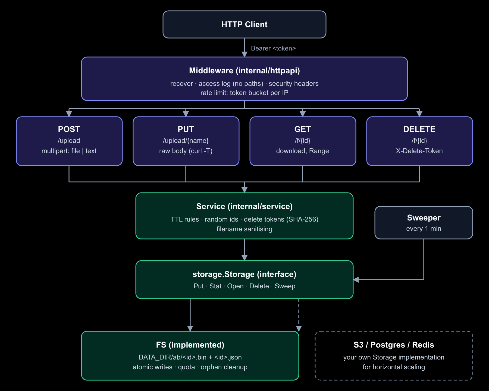

# ttlbox

<div align="center">


<p align="center">
  Self-hosted сервис для файлов и текста, которые удаляются сами через выбранное время. Один бинарник на <b>Go</b>, только стандартная библиотека, без базы данных.
</p>

[Особенности](#ключевые-особенности) •
[Архитектура](#архитектура) •
[Быстрый старт](#быстрый-старт) •
[API Reference](#api-reference) •

---

</div>

## Ключевые особенности

- **Авто-удаление**: срок жизни от секунд до `MAX_TTL` (`30m`, `12h`, `7d`), просроченное недоступно сразу и чистится фоново раз в минуту.
- **Файлы и текст**: загрузка через `multipart/form-data` или сырым телом (`curl -T`), скачивание с поддержкой `Range`.
- **Доступ по ссылке**: короткий случайный id из 12 символов (~62 бита), перебором не подобрать из-за лимитов и срока жизни. Для каждой загрузки выдаётся свой delete-токен.
- **Защита из коробки**: токен загрузки, лимиты запросов по IP, квоты диска, строгие заголовки, контейнер без root.
- **Масштабируемость**: сервер stateless, хранилище спрятано за интерфейсом `storage.Storage`.
- **Деплой на свой сервер**: `docker compose up`, настройка через переменные окружения.

---

## Архитектура

<div align="center">
  
</div>

Зависимости направлены в одну сторону: `httpapi → service → storage.Storage`. Заменить хранилище или добавить другой транспорт (gRPC, CLI) можно, изменив один пакет.

### Стек технологий

| Компонент | Технология | Назначение |
| :--- | :--- | :--- |
| **Language** | [Go](https://go.dev/) 1.22+ | `net/http` с методами в роутах, `log/slog` |
| **HTTP** | `net/http` | Роутинг, стриминг multipart, таймауты |
| **Storage** | Файловая система | Атомарные записи (temp + rename), шардирование по id |
| **Security** | `crypto/rand`, `crypto/sha256`, `crypto/subtle` | Идентификаторы, хеши токенов, сравнение за постоянное время |
| **Deploy** | Docker (distroless) | Образ без shell, запуск не от root |

---

## Структура проекта

```tree
ttlbox/
├── cmd/
│   └── ttlbox/
│       └── main.go           # Сборка зависимостей, graceful shutdown, фоновая чистка
├── internal/
│   ├── config/               # Переменные окружения → проверенный Config
│   │   └── config.go
│   ├── dur/                  # Разбор длительностей с суффиксом d (дни)
│   │   └── dur.go
│   ├── httpapi/              # HTTP-слой
│   │   ├── handler.go        # Роуты и обработчики загрузки, скачивания, удаления
│   │   └── middleware.go     # Заголовки безопасности, лимиты, логи, recover
│   ├── ratelimit/
│   │   └── ratelimit.go      # Token bucket по ключу (IP)
│   ├── service/
│   │   └── service.go        # Правила TTL, ids, delete-токены, имена файлов
│   └── storage/
│       ├── storage.go        # Интерфейс Storage, генерация и проверка id
│       └── fs.go             # Реализация на файловой системе
├── docs/
│   ├── architecture.svg      # Исходник схемы
│   └── architecture.png      # Схема для README
├── Dockerfile
├── docker-compose.yml
└── README.md
```

---

## Быстрый старт

### 1. Docker Compose

```bash
export UPLOAD_TOKEN=$(openssl rand -hex 16)
docker compose up -d --build
```

Сервис слушает `127.0.0.1:8080`. Наружу его стоит отдавать через reverse proxy с TLS (Caddy, nginx, Traefik).

### 2. Локальный запуск

```bash
UPLOAD_TOKEN=$(openssl rand -hex 16) go run ./cmd/ttlbox
```

### 3. Конфигурация

Все параметры задаются переменными окружения. Неверное значение останавливает запуск, а не игнорируется.

| Переменная | По умолчанию | Описание |
| :--- | :--- | :--- |
| `UPLOAD_TOKEN` | пусто | Токен загрузки, минимум 16 символов. Пусто = загрузка открыта всем (в логах предупреждение) |
| `ADDR` | `:8080` | Адрес прослушивания |
| `DATA_DIR` | `./data` | Папка хранилища (в Docker `/data`) |
| `BASE_URL` | из запроса | Публичный адрес для ссылок в ответе, например `https://files.example.com` |
| `MAX_SIZE_MB` | `50` | Максимальный размер одной загрузки |
| `MAX_TOTAL_MB` | `0` | Квота на всё хранилище, `0` = без лимита |
| `DEFAULT_TTL` | `24h` | Срок жизни по умолчанию |
| `MAX_TTL` | `7d` | Максимально допустимый срок |
| `UPLOAD_RATE` | `20` | Запросов загрузки в минуту с одного IP, `0` = выкл |
| `DOWNLOAD_RATE` | `300` | Запросов скачивания и удаления в минуту с одного IP, `0` = выкл |
| `TRUST_PROXY` | `false` | Доверять `X-Forwarded-For` и `X-Forwarded-Proto` от вашего прокси |

---

## API Reference

| Метод и путь | Назначение | Авторизация | Успех |
| :--- | :--- | :--- | :--- |
| `POST /upload` | Загрузка файла или текста | Bearer-токен | `200` |
| `PUT /upload/{name}` | Загрузка сырым телом | Bearer-токен | `200` |
| `GET /f/{id}` | Скачивание | нет, ссылка и есть доступ | `200` |
| `DELETE /f/{id}` | Досрочное удаление | `X-Delete-Token` | `204` |
| `GET /healthz` | Проверка живости | нет | `200` |

Токен загрузки нужен, только если задан `UPLOAD_TOKEN`.

### 1. Загрузка файла или текста

```http
POST /upload
Authorization: Bearer <UPLOAD_TOKEN>
Content-Type: multipart/form-data
```

**Поля формы:**

| Поле | Обязательно | Описание |
| :--- | :--- | :--- |
| `file` | да (или `text`) | Загружаемый файл |
| `text` | да (или `file`) | Текст вместо файла, до 1 МБ. Если переданы оба, берётся `text` |
| `ttl` | нет | Срок жизни: `30m`, `12h`, `7d`. По умолчанию `DEFAULT_TTL` |
| `token` | нет | Токен загрузки, если не передан заголовком `Authorization` |

> Поля `ttl` и `token` должны идти **до** `file` и `text`: загрузка идёт потоком и авторизуется до записи первого байта.

```bash
curl -H "Authorization: Bearer $TOKEN" -F ttl=1h -F file=@photo.png https://host/upload
curl -H "Authorization: Bearer $TOKEN" -F ttl=10m -F text='hello' https://host/upload
```

**Ответ (`200 OK`, `text/plain`):**
```
https://host/f/k7xp2mq9a4zd
delete-token: ca8dd639e79e111419ae1823b6489d55
expires: 2026-10-22T15:44:35Z
```

С заголовком `Accept: application/json`:
```json
{
  "url": "https://host/f/k7xp2mq9a4zd",
  "delete_token": "ca8dd639e79e111419ae1823b6489d55",
  "expires": "2026-10-22T15:44:35Z"
}
```

---

### 2. Загрузка сырым телом

```http
PUT /upload/{name}?ttl=1h
Authorization: Bearer <UPLOAD_TOKEN>
```

Имя файла берётся из пути, срок из параметра `ttl`. Ответ такой же, как у `POST /upload`.

```bash
curl -H "Authorization: Bearer $TOKEN" -T photo.png "https://host/upload/photo.png?ttl=1h"
```

---

### 3. Скачивание

```http
GET /f/{id}
```

Файлы отдаются как вложение (`application/octet-stream`), текст как `text/plain`. Заголовок `X-Expires` показывает, когда содержимое исчезнет. Поддерживаются `Range`-запросы.

```bash
curl -O -J https://host/f/k7xp2mq9a4zd
```

---

### 4. Удаление

```http
DELETE /f/{id}
X-Delete-Token: <delete-token>
```

```bash
curl -X DELETE -H "X-Delete-Token: ca8dd639e79e111419ae1823b6489d55" https://host/f/k7xp2mq9a4zd
```

**Ответ:** `204 No Content`.

---

### Коды ошибок

| Код | Причина |
| :--- | :--- |
| `400` | Нет `file` или `text`, неверный или недопустимый `ttl`, запрос не multipart |
| `401` | Нет токена загрузки или он неверный |
| `403` | Неверный delete-токен |
| `404` | Нет такого id или срок истёк |
| `413` | Загрузка больше `MAX_SIZE_MB` (текст больше 1 МБ) |
| `429` | Превышен лимит запросов, смотрите `Retry-After` |
| `507` | Исчерпана квота `MAX_TOTAL_MB` |

---

## Хранилище и масштабирование

Данные лежат в `DATA_DIR`: для каждой загрузки два файла, `<id>.bin` и `<id>.json` с метаданными, в подпапке по первым двум символам id. Файл становится видимым только после появления `.json`, поэтому недописанных загрузок никто не увидит.

Сервер сам ничего не хранит, поэтому реплики за балансировщиком работают, если у них общий `DATA_DIR` (NFS, EFS). Срок проверяется при каждом чтении, а чистка безопасна при параллельном запуске.

Для S3 или Postgres нужно написать свою реализацию `storage.Storage` (5 методов), остальной код не меняется. Пока лимиты запросов и счётчик квоты считаются на каждой реплике отдельно, строгий общий лимит ставьте на прокси.

---

## Качество кода

```bash
gofmt -l .
go vet ./...
go build ./...
```
